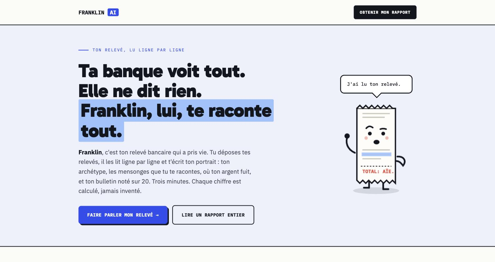
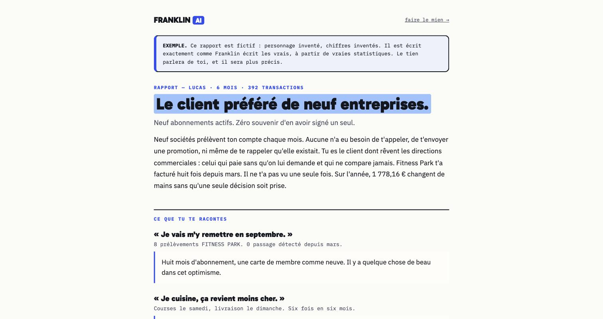

# Franklin AI

Tu déposes tes relevés bancaires en PDF, Franklin les lit ligne par ligne et rédige ton portrait financier : ton archétype de dépensier, les écarts entre ce que tu crois faire et ce que montrent tes relevés, les abonnements qui tournent sans toi, et une note de gestion sur 20.

**Site : [franklinai.fr](https://www.franklinai.fr)**



## Le parcours

1. Dépôt d'un ou plusieurs relevés PDF, toutes banques françaises.
2. Aperçu gratuit immédiat : trois constats chiffrés tirés du relevé.
3. Paiement (Stripe) pour débloquer le rapport complet.
4. Rapport généré en une minute environ, consultable par lien privé et téléchargeable en PDF.
5. Suppression automatique des données 30 jours après l'analyse.



## La règle du produit : l'IA n'invente aucun chiffre

Sur un produit qui parle d'argent, un seul chiffre faux détruit la confiance. L'architecture sépare donc strictement le calcul de la rédaction :

| Étape | Qui la fait | Module |
|---|---|---|
| Lecture du PDF et extraction des opérations | Claude (vision), avec contrôle : somme des opérations comparée aux totaux imprimés sur le relevé | `lib/vision.ts` |
| Reconnaissance des libellés (commerçant, abonnement, salaire, virement) sur douze banques françaises | Code | `lib/enrich.ts` |
| Statistiques : abonnements, récurrences, catégories, épargne | Code, déterministe | `lib/stats.ts` |
| Note sur 20 et ses cinq sous-notes | Code, déterministe | `lib/note.ts` |
| Rédaction des sections du rapport | Claude, à partir des statistiques uniquement | `lib/franklin.ts` |
| Validation finale | Code : tout chiffre du texte absent des statistiques fait rejeter la rédaction, qui est relancée | `lib/franklin.ts` |

Un critère impossible à mesurer (un seul relevé, pas de salaire récurrent) est neutralisé dans la note au lieu d'être compté zéro.

## Stack

- Next.js 14 (App Router), TypeScript, déployé sur Vercel
- API Anthropic (lecture des relevés et rédaction)
- Supabase (PostgreSQL) pour les rapports
- Stripe Checkout et webhook pour le paiement
- pdf-lib pour générer le PDF du rapport sans navigateur headless
- Tâches planifiées Vercel : purge des données à J+30, relances

## Structure

```
app/
  route.ts             page d'accueil
  analyse/             dépôt des relevés et aperçu
  rapport/             rapport complet (lien privé)
  exemple/             rapport fictif de démonstration
  api/                 upload, checkout, webhook Stripe, purge, relance
lib/                   moteur : vision, enrichissement, stats, note, rédaction, PDF
tests/banques.mjs      libellés réels de douze banques françaises
supabase-schema.sql    schéma de la base
DEPLOY.md              variables d'environnement et mise en production
```

## Lancer en local

```
npm install
npm run dev
```

Sans clé Stripe, le paiement est simulé. Sans Supabase, les rapports sont gardés en mémoire. Le détail des variables d'environnement est dans `DEPLOY.md`.
